<picture>
  <source media="(prefers-color-scheme: dark)" srcset="./assets/header-dark.svg">
  <source media="(prefers-color-scheme: light)" srcset="./assets/header-light.svg">
  
</picture>

 

### `01 · about`

Electrical Engineer. **BSc from UFJF**, **MSc from USP**.
I work on **mathematical modeling, machine learning and complex computational systems**.
My focus is problems where **structure, data and uncertainty** meet.
That means mathematical models that must survive contact with noisy, real-world data.

- `theory` · statistics, optimization and linear algebra applied to real problems
- `implementation` · software, data pipelines and ML models in production
- `systems` · bridging electronics, computing and AI

 

### `02 · featured work`

| | Project | What it does | Core idea |
|:-:|---|---|---|
| ◆ | **[private-llm-chat](https://github.com/cassianorcarneiro/private-llm-chat)** | Self-hosted chat portal for local LLMs on a single-GPU home server. Opt-in web search with cited answers. Persistent history. | LangGraph pipeline: SearXNG fetch, rerank, cite. Rolling summaries bound context growth. FastAPI + React in one Docker Compose stack. |
| ◆ | **[sunside-route-analyzer](https://github.com/cassianorcarneiro/sunside-route-analyzer)** | Tells which side of the vehicle (left/right) gets less direct sunlight along a driving route, for given departure and arrival times. | Segment-by-segment comparison of solar position against vehicle heading at each segment's timestamp. |
| ◆ | **[ai-powered-financial-dashboard](https://github.com/cassianorcarneiro/ai-powered-financial-dashboard)** | Personal finance dashboard with local CSV persistence. | Local LLM generates analytical insights, fully offline. |

 

### `03 · stack`

| Layer | Tools | Used for |
|---|---|---|
| **Languages** |     | Python for ML and research code. C++ for performance-critical code. R for statistics. |
| **Modeling** |    | Model training, evaluation and research experiments. |
| **LLM systems** |     | Local inference, retrieval pipelines and agent systems. |
| **Data** |   | Pipelines and analysis on noisy, real-world data. |
| **Infra** |     | Containerized deployment, cloud services and self-hosted infrastructure. |
| **Web** |     | APIs, dashboards and interfaces for ML tools. |
| **Enterprise** |   | CRM and systems integration consulting. |

 

### `04 · what you'll find here`

- `ml` · experiments in machine learning and data science
- `sim` · mathematical modeling and simulation
- `agents` · multi-agent systems on local LLMs, privacy-first
- `algo` · algorithms for practical, everyday problems
- `papers` · implementations of papers from the technical literature

 